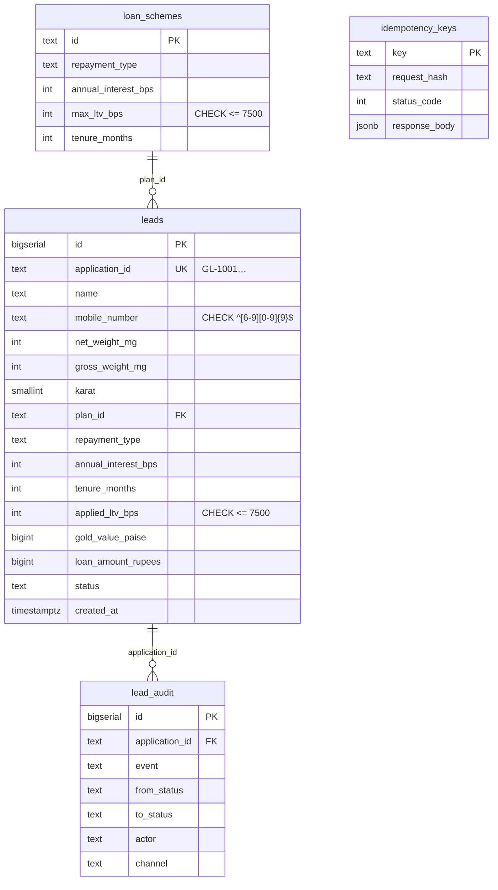
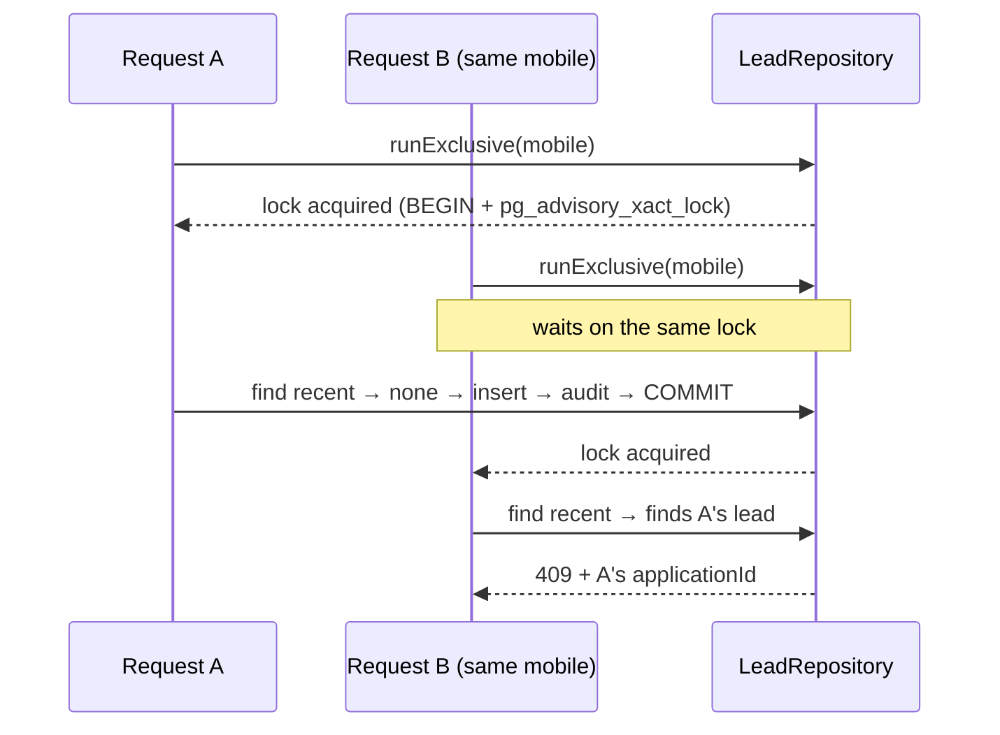

# Architecture

This document explains how the Gold Loan Portal is put together and why. The short version: **one set of business rules, reached through two front doors** (the web form and the AI agent), with money maths that cannot drift.

## 1. System context

```mermaid
flowchart LR
  subgraph Browser
    W[React SPA<br/>apply · track · admin · chat]
  end
  subgraph API["Node + Express API (TypeScript)"]
    R[HTTP routes<br/>Zod validation]
    A[AgentOrchestrator<br/>tools · guards · sessions]
    S[Services<br/>QuoteService · LeadService · GoldRate]
    D[Domain<br/>QuoteCalculator · Lead · LoanScheme]
    Repo[(Repositories<br/>memory | postgres | cached)]
  end
  DB[(PostgreSQL)]
  LLM[[LLM provider<br/>Claude Opus 5.5 via Anthropic SDK<br/>/ OpenAI-compatible / offline engine]]

  W -- REST /api/v1 --> R
  W -- /chat, /chat/confirm --> R
  R --> S
  R --> A
  A -- tools call the same services --> S
  A -. HTTPS, server side only .-> LLM
  S --> D
  S --> Repo --> DB
```

Key decisions:

- The browser never talks to an LLM. Keys live on the server and the model only ever sees what the orchestrator sends.
- The agent is **not** a second implementation of the loan rules. Its tools call `QuoteService` and `LeadService`. A lead filed by chat and a lead filed by the form are identical rows (only the audit `channel` differs).
- `packages/shared` holds the Zod schemas, constants, formatting and masking, so the API, the agent tools and the web form validate with the same objects and cannot disagree.

## 2. Layers and object-oriented design

| Layer | Classes | Responsibility | Depends on |
| --- | --- | --- | --- |
| Domain | `QuoteCalculator`, `LoanScheme`, `Lead` | Pure rules: maths, plan terms, status transitions (`Lead.canTransitionTo`). No I/O, no framework | `shared` only |
| Services | `QuoteService`, `LeadService`, `GoldRateProvider` (`MockGoldRateProvider`, `CachedGoldRateProvider`) | Use cases. `LeadService.submit` is the single place a lead is created | Domain, repository **interfaces** |
| Repositories | `MemoryRepositories`, `PostgresRepositories`, `CachedLoanSchemeRepository` | Persistence behind interfaces (`LeadRepository`, `LoanSchemeRepository`) | `pg`, domain |
| Agent | `AgentOrchestrator`, `ToolRegistry` + `AgentTool` subclasses, `SessionStore`, `InputGuard`, `GroundingGuard`, `LlmProvider` implementations | Conversation control | Services, shared |
| HTTP | route factories, middleware | Translate HTTP ⇄ services; one error handler | Services, agent |
| Composition root | `buildContainer()` in `container.ts` | The only place concrete classes are wired together | everything |

The principles in use:

- **Dependency inversion:** services depend on the `LeadRepository` / `LoanSchemeRepository` interfaces. The tests and evals run the exact same service code on the in-memory repositories, and production runs it on PostgreSQL.
- **Open/closed with polymorphism:**
  - Add an LLM vendor by implementing `LlmProvider`.
  - Add an agent capability by subclassing `AgentTool`, which carries its own name, JSON schema, Zod schema and `execute`.
  - Add a gold-rate feed by implementing `GoldRateProvider`.
  - None of these edits existing code.
- **Encapsulation:** `Lead` owns its allowed status transitions, `LoanScheme` is an immutable value object, and `QuoteCalculator` is the only file that contains the money formulas (including the 75% cap).
- **Decorator:** `CachedLoanSchemeRepository` and `CachedGoldRateProvider` add caching without the services knowing.
- **Single composition root,** which makes dependencies explicit and every test able to build its own isolated "world" (`makeWorld()`).

## 3. Money maths (no floats)

- Weight → integer **milligrams**, money → integer **paise**, percentages → **basis points**. All arithmetic is `BigInt`.
- Each figure is computed with **one division at the end**, so there is no accumulated rounding:

```
goldValuePaise = floor(netMg × karat × ratePaisePerGram / (24 × 1000))
loanRupees     = floor(netMg × karat × ratePaise × ltvBps / (24 × 1000 × 10 000 × 100))
ltvBps         = min(plan.maxLtvBps, 7500)           // the 75% cap is enforced in code and by a DB CHECK
```

- Pure gold in milligrams is for display only (rounded to the nearest mg).
- The input schema accepts at most 3 decimals of a gram, so the gram→mg conversion is exact.
- The server **recomputes** on `POST /leads`. Unknown keys (such as a client-sent `eligibleLoan`) are stripped by the schema, so a tampered client cannot change the stored loan amount.

Worked check (net 45 g, 22 K, ₹7,000/g): pure 41.25 g → value ₹2,88,750 → Bullet 70% = ₹2,02,125, EMI 75% = ₹2,16,562 (floor of 2,16,562.5).

## 4. Data model (PostgreSQL)



- **Constraints are the last line of defence:** name length, mobile regex, `0 < net ≤ gross ≤ 1 000 000 mg`, karat ∈ {18, 22, 24}, LTV ≤ 7500 bps, status enum. Even a buggy caller cannot store an invalid row.
- `application_seq` produces `GL-1001`, `GL-1002`, …: unique and increasing even under concurrent inserts. Like any PostgreSQL sequence it can skip numbers (it reserves values 32 at a time, so a database restart can jump e.g. from GL-1004 to GL-1037); that is harmless for an application id.
- **Offer snapshot (migration `002_lead_plan_terms.sql`):** each lead stores the plan terms it was filed with (repayment type, interest, tenure, applied LTV). EMI / interest shown later is recomputed from those terms with the same `QuoteCalculator`, so an application's offer never changes if a plan is edited. Older rows were backfilled from `loan_schemes`.
- **Indexes:** `(mobile_number, created_at DESC)` serves the duplicate check, and `(created_at DESC, id DESC)` serves the newest-first admin list (`id` is the tie-breaker, so paging is stable).
- Migrations are numbered SQL files, each applied once in its own transaction and recorded in `schema_migrations`; the seed upserts the two plans (`ON CONFLICT … DO UPDATE`).

## 5. Concurrency: "same mobile, same moment"

A naive "SELECT, then INSERT" lets two parallel requests both pass the check. The design:



- **PostgreSQL:** one transaction per submission with `pg_advisory_xact_lock(hashtextextended(mobile, 0))`. The lock is released on commit or rollback, with no cleanup code needed.
- **Memory:** an equivalent promise-chain mutex keyed by mobile.
- Different mobiles do not block each other.
- **Idempotency-Key:** inside the same lock, a stored `(key → request hash, status, body)` is replayed verbatim (`Idempotent-Replayed: true`). The same key with a different body gives 422. Without this, a double-click or a retry after a network blip would show the user a confusing 409 for their own first request.
- **Status changes** use compare-and-set (`UPDATE … WHERE status = :from`), so two admins cannot both apply conflicting transitions.
- The 7-day window uses an injected `Clock`, so tests move time without sleeping.

## 6. API contract and errors

- Versioned under `/api/v1`. JSON only. Body limit 50 kB.
- One error shape everywhere: `{ "error": { "code", "message", "fields": [{ "field", "message" }], "details"? } }`.

| HTTP | `code` | When |
| --- | --- | --- |
| 400 | `VALIDATION_ERROR` | Schema or rule failure; `fields` names the inputs |
| 400 / 413 | `INVALID_JSON`, `PAYLOAD_TOO_LARGE` | Malformed or oversized body (413 above 50 kB) |
| 404 | `PLAN_NOT_FOUND`, `LEAD_NOT_FOUND`, `ROUTE_NOT_FOUND` | Unknown plan, application or route |
| 409 | `DUPLICATE_APPLICATION` | Same mobile within 7 days; `details.applicationId` |
| 409 | `INVALID_STATUS_TRANSITION` | Illegal workflow move |
| 422 | `IDEMPOTENCY_KEY_REUSED` | Same key, different body |
| 429 | `RATE_LIMITED` | Per-IP limit hit; `Retry-After` header |
| 500 | `INTERNAL_ERROR` | Anything unexpected: generic message, **no stack trace**, logged with the request id |

- Validation lives in one middleware (`validateBody` / `validateQuery`). Handlers are wrapped by `asyncHandler`, and a single `createErrorHandler` maps `AppError` subclasses (and malformed JSON, oversized bodies and unknown errors) to the shape above.

## 7. Performance

Quotes are cheap by construction: a handful of BigInt operations, no database access. `POST /quotes` is a pure function of the request, a cached rate and cached plans.

| Concern | Technique |
| --- | --- |
| Plans are read on every quote | `CachedLoanSchemeRepository`: the list of active plans is held in memory for a short TTL |
| Gold rate | `CachedGoldRateProvider`: TTL cache that also coalesces concurrent refreshes into one call |
| Quote on every keystroke | Web debounces 300 ms, aborts superseded requests with `AbortController`, and caches by input |
| Duplicate check | Covered by the `(mobile_number, created_at)` index; the lookup is an index range scan |
| Admin list | Ordered by an index on `(created_at DESC, id DESC)`; page size capped at 100 |
| Payload size | `compression`, `Cache-Control: public, max-age=30` on plans and rate, `no-store` on personal data, minified Vite production build |
| Connections | Pooled `pg` client; `keepAliveTimeout` raised above typical proxy idle time |
| Chat latency | Deterministic fast paths: the offline engine answers in microseconds. With a real LLM, at most `AGENT_MAX_TOOL_STEPS` round-trips and a hard `LLM_TIMEOUT_MS` |

## 8. Security and privacy

- **Input:** Zod on every body, query and tool argument. Unknown keys are stripped. Parameterised SQL only.
- **Headers/CORS:** `helmet`, an explicit CORS origin list, `x-powered-by` off.
- **Abuse:** per-IP rate limiting on lead creation and chat.
- **PII:** mobile numbers are stored in full (needed for duplicates) but **masked on every output**: API list, audit responses, agent tool results and the agent's replies. Logs record outcomes, ids and a shortened session id, not names or mobile numbers.
- **Secrets:** environment variables only. `.env` is ignored by git, `.env.example` holds empty placeholders, and the LLM key never leaves the server.
- **Errors:** no stack traces, SQL or internals in responses.
- **Known gap:** the admin endpoints have no authentication (the brief doesn't ask for it). This is listed in the README with the plan to add it.

## 9. Frontend architecture

- One single-page app with an applicant side (**Apply**: one scrollable page in three numbered sections with a sticky progress bar; **Track**: application id + mobile → full details and status history; **Loan Assist** chat) and an admin side (**Admin**: the leads table plus a details drawer with status actions and the full history). The brief asks for one SPA with an admin view, so there is no separate admin portal or login.
- Vite + React + TypeScript, plain CSS design tokens: flat white / black surfaces, hairline borders and a single gold accent, with faded gold photography in the page background. Light (gold & white, default) and dark (gold & black) themes via `data-theme`, with a pre-paint script to avoid a flash. Fonts (DM Sans, Playfair Display) are self-hosted through Fontsource, so there are no third-party requests.
- State is local to each component; there is no global store because there is no cross-page shared state worth one. `useQuote` (debounce, abort, cache), `useTheme`, `useHealth` and `useHistory` are the only hooks that matter.
- The form validates with the same `CreateLeadSchema` as the server, so messages match. The server stays the authority, and a 400 maps `fields[]` back onto the inputs.
- A single `api/client.ts` owns fetch, error parsing (`ApiError`) and the `Idempotency-Key` header. A key is generated per distinct payload and reused on retry.
- Accessibility: labelled inputs with `aria-describedby` errors, the progress bar jumps to each section, the admin drawer is a focus-trapped dialog (Esc closes), `aria-live` for quote and chat updates, and visible focus rings. The chat panel is inert while closed.
- Storage access (`localStorage`/`sessionStorage`) is always inside try/catch so private-mode browsers still work.

## 10. Testing strategy

| Level | Where | What it proves |
| --- | --- | --- |
| Unit | `packages/shared/tests`, `quoteCalculator.test.ts` | Schemas, masking, formatting, maths against the brief's examples (including rounding edges and the 75% cap) |
| Service | `leadService.test.ts` | Test cases 1–8 from the brief, 7-day window with a fake clock, idempotency, 20 parallel submissions → one 201, status workflow and audit |
| Agent | `agent.test.ts`, `guards.test.ts`, `providers.test.ts` | The 5 required conversations, guard behaviour, confirmation rules, provider request and response mapping (scripted LLM) |
| HTTP | `http.test.ts` | The real Express stack over a socket: status codes, error shape, 500 without stack, 429 |
| Database | `postgres.test.ts` (needs `TEST_DATABASE_URL`) | Advisory-lock concurrency and DB CHECK constraints against real PostgreSQL |
| Behavioural | `npm run eval` | 16 end-to-end chat scenarios (optionally against a live LLM) |

CI runs all of them, with a PostgreSQL service, on each push.

## 11. Scaling path

1. **Stateless API instances** behind a load balancer: lead correctness already lives in PostgreSQL (advisory locks, unique keys), not in process memory.
2. Move `SessionStore` and the rate limiter to **Redis**. Both are behind small classes.
3. Read replica for the admin list; partition `lead_audit` by month if it grows large.
4. Background queue (e.g. BullMQ) for notifications to the customer once a status changes.
5. Replace the mock rate with a vendor feed behind `GoldRateProvider`, with a staleness alarm.
