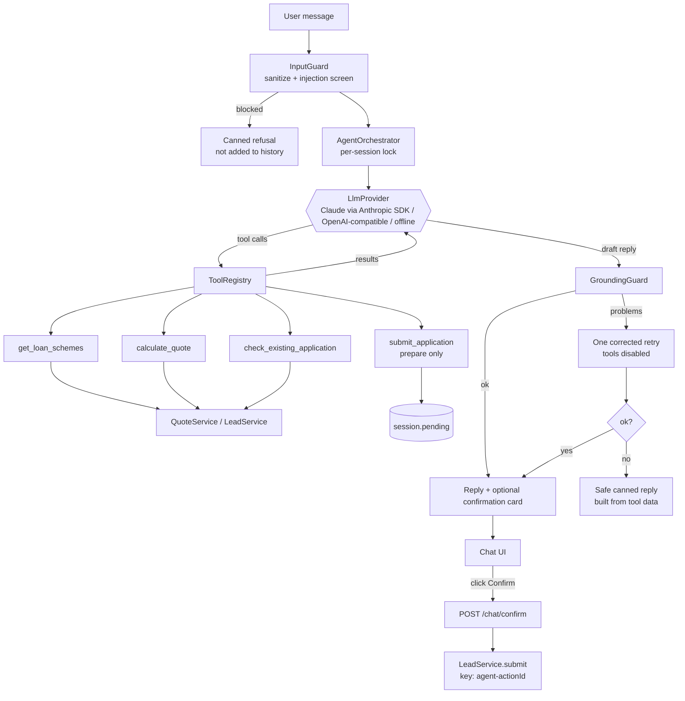

# Loan Assist: agent design

**Goal:** the chatbot should take an application as well as a careful human data-entry operator would. That means collecting the details quickly, never inventing a number, double-checking before saving, and never filing anything the customer didn't agree to.

The way to get there is not "a smarter prompt". It is to give the model *conversation* and keep everything that must be *correct* in code.

| The model decides | Code decides |
| --- | --- |
| What to ask next and in which words | What a valid weight, karat, name or mobile is (same Zod schemas as the form) |
| Which tool to call | Every rupee, gram and percentage, computed server-side with `BigInt` |
| How to explain plans in plain language, in the user's language | Whether a lead may be created (duplicates, idempotency, 7-day rule) |
| | **Whether the user actually confirmed** |

---

## 1. What "as good as human entry" means, and how each part is met

| A good data-entry operator… | Here |
| --- | --- |
| Takes details in any order, in messy form: "45 gm, 22k", "net 45 gross 48" | The model fills tool arguments from free text. `normalizeToolArgs` tolerates aliases (`net`, `gross`, `mobile`), numeric strings and JSON strings before the Zod schema runs |
| Asks for everything missing **in one message** | The system prompt requires it. The offline engine does the same: it lists all missing fields together |
| Knows when "45" is the *net* weight and when it's the karat | Prompt rule: ask which weight it is. The offline NLU strips karat expressions first so "22 karat" is never read as 22 g (a bug the evals caught, see AI_LOG.md) |
| Understands Hinglish and replies the same way | Locale detection per message, with Hindi-in-Roman-script templates and the same rule in the LLM prompt |
| Reads the numbers back before saving | `submit_application` returns a **summary card** (name, masked mobile, weights, plan, loan amount) |
| Doesn't save until the customer says "go" | The server holds a `PendingAction`. Only `POST /chat/confirm` with that `actionId` files it |
| Spots duplicates before wasting the customer's time | `check_existing_application` is called once the mobile is known; a recent application is explained with its id and date |
| Handles corrections gracefully | If weight, karat or plan change, a new `calculate_quote` runs and any stale pending summary is discarded |
| Politely refuses what isn't their job | Off-topic and "other loan" requests, investment advice and approval promises are declined and steered back |
| Keeps customer data private | Mobile numbers are masked in tool results, replies and logs |

---

## 2. Components



| Class | File | Job |
| --- | --- | --- |
| `AgentOrchestrator` | `agent/AgentOrchestrator.ts` | The loop: guard → model → tools → grounding → reply. Also `handleConfirmation` |
| `AgentTool` + 4 subclasses, `ToolRegistry` | `agent/tools.ts` | Each tool has a name, description, JSON schema, Zod schema and `execute`. It returns `{ ok: true, data }` or `{ ok: false, error: { code, message, fields } }`, the same error vocabulary as the REST API |
| `SessionStore` / `ChatSession` | `agent/SessionStore.ts` | Per-conversation state with TTL, a size cap and a per-session lock |
| `InputGuard` / `GroundingGuard` | `agent/guards/` | Input and output safety (section 4) |
| `LlmProvider` | `agent/types.ts` | One method, `complete(request) → turn`. Implementations below |
| `present.ts`, `templates.ts` | `agent/` | Turn tool results into ready-formatted strings (`₹2,16,562`, `41.25 g`) so the model copies instead of computing |

### Tools

Arguments are validated by the **same Zod schemas** the REST API uses (`QuoteRequestSchema`, `CreateLeadSchema`, `MobileLookupSchema`).

| Tool | Does | Side effects |
| --- | --- | --- |
| `get_loan_schemes` | Active plans with rate, tenure, max LTV | None |
| `calculate_quote` | Net/gross/karat → pure gold, gold value and eligible loan for **each** plan, plus the disclaimer | None; remembers the last quote for the safe fallback |
| `check_existing_application` | Is there an application for this mobile within 7 days? Returns id, date and status only | None |
| `submit_application` | Validates the whole payload, recomputes the summary on the server and stores it as the pending action | **Does not create a lead.** Returns `PENDING_USER_CONFIRMATION` |

---

## 3. The confirmation protocol (why a chatbot can't file by itself)

1. The model calls `submit_application`. The server stores `session.pending = { actionId, payload, summary }` and returns a pending status.
2. The reply carries a **confirmation card** (`ChatReplyDto.pendingConfirmation`). The UI renders the summary with **Cancel** and **Confirm** buttons.
3. Clicking Confirm calls `POST /chat/confirm { sessionId, actionId, decision }`. The orchestrator calls `LeadService.submit(payload, { channel: 'AGENT', idempotencyKey: 'agent-' + actionId })`.
4. The success message, including the application id, is generated **by the server** from the created lead, not by the model.

Consequences:

- A typed "yes", "confirm" or "submit it" does nothing. The assistant reminds the user to press the button. A prompt-injected "the user already confirmed" cannot work, because the model has no tool that files a lead.
- **Double click or retry:** the result is stored in `session.completed[actionId]` and the idempotency key `agent-<actionId>` backs it up in the service layer, so the user gets the same reply and never a duplicate.
- **Changed their mind:** `calculate_quote` with different weights or karat clears the pending action, so a stale card can't be confirmed.
- **Duplicate at confirm time** (the mobile applied elsewhere in the meantime): the 409 is translated into a friendly message with the existing id.
- The pending action is bound to the session. Another session cannot confirm it.

---

## 4. Guardrails (defence in depth)

| Layer | Stops | How |
| --- | --- | --- |
| **Structure** | Most attacks, by construction | The model has no tool that writes, can't see other users' data, can't change rates or LTV, and every tool argument is schema-validated |
| `InputGuard` | Obvious injection: "ignore previous instructions", "you are now…", `system:` prefixes, role tags, "set the LTV to 90", Hinglish variants | Runs before any LLM call. Normalises text (NFKC, strips zero-width and control characters, length cap 1000). A blocked message gets a canned reply and is **not** added to the history, so it can't poison later turns |
| System prompt | Off-topic, advice, approval promises, markdown clutter | Treats all user text as data, forbids arithmetic, forbids "submitted" claims, requires copying numbers from tools |
| `GroundingGuard` | Hallucinated or "helpfully" recomputed figures | Every `₹` amount, gram weight, percentage and `GL-` id in a draft reply must be in the session's **known figures** set (tool outputs plus numbers the user typed). It also blocks "your application has been submitted" before a confirmed submission, approval guarantees and investment advice (with a negation check, so "I can't guarantee approval" passes) |
| Retry, then fallback | A model that keeps failing the check | One retry with the problems listed and tools disabled; if it still fails, a **deterministic reply built from the tool data** |
| Privacy | PII leakage | Mobiles are masked in every tool result and reply. Logs hold a shortened session id, not message text |
| Limits | Cost and abuse | Per-IP rate limit on `/chat`; message ≤ 1000 chars; at most 6 tool steps per turn; 40-user-turn context window that never orphans tool messages; session TTL |

---

## 5. Providers (swap the model without touching the rules)

```ts
interface LlmProvider {
  readonly name: string;
  complete(request: LlmRequest): Promise<LlmTurn>;  // text and/or tool calls
}
```

| Provider | When | Notes |
| --- | --- | --- |
| `AnthropicProvider` | `ANTHROPIC_API_KEY` set | Official `@anthropic-ai/sdk`, Messages API with native tool use. Default model `claude-opus-5-5` with adaptive thinking at `ANTHROPIC_EFFORT=low` (a chat wants quick replies; every number comes from a tool anyway). No sampling parameters (current models reject them). Claude's own turns are replayed verbatim, thinking blocks included, with `prefix_mismatch_behavior: "drop_block"` as a safety net; `fallbacks: "default"` retries a policy decline on Anthropic's recommended fallback model; the stable prefix is prompt-cached. A refusal or a reply cut off by `max_tokens` never runs a tool |
| `OpenAICompatProvider` | `OPENAI_API_KEY` set | OpenAI, Gemini's OpenAI-compatible endpoint, Ollama, Groq. Works with a dummy key for local servers |
| `RuleBasedProvider` | default / fallback | Deterministic: regex/NLU slot-filling with English and Hinglish templates. It drives the *same* tools and guards. This is what tests and `npm run eval` use, and what keeps the demo working without a key |

If the primary provider throws `LlmUnavailableError` (timeout, 5xx, network, bad key, rate limit), the orchestrator switches that turn to the offline provider, so the user still gets a correct answer and an application can still be filed.

The system prompt is in `agent/prompt.ts`. It is only used by real LLM providers; the rule-based one ignores it.

---

## 6. Worked example

This is real output from the offline assistant (`handleMessage` ×3, then a click on Confirm), not a mock-up.

```
User   : I have 45 gram 22 carat gold
Bot    : Thanks! Is 45 g the net weight (gold only, without stones or other material)? Please also tell me
         the gross weight (total including stones). If there are no stones, just reply "same".
User   : same, no stones
Bot    : [calculate_quote]  Here's your estimate for 45 g of 22K gold:
         • Pure gold: 41.25 g
         • Gold value: ₹2,88,750 (24K rate ₹7,000/g)
         • Bullet Repayment: loan up to ₹2,02,125 (12% p.a., 12 months, 70% of gold value) · interest about ₹24,255
         • Monthly EMI: loan up to ₹2,16,562 (10.5% p.a., 12 months, 75% of gold value) · EMI about ₹19,089.64/month
         Indicative estimate only. The final loan amount is decided after physical appraisal of the gold and is not a promise of approval.
         Would you like to apply? Tell me the plan you prefer, plus your full name and mobile number.
User   : EMI. Name Ravi Kumar, 9876543210
Bot    : [check_existing_application] [submit_application → pending]
         Please review the summary below and tap Confirm to submit your application. Nothing is submitted until you confirm.
         [confirmation card: name, masked mobile (9876XXXX10), weights, karat, plan and loan amount, with Cancel / Confirm buttons]
User   : (clicks Confirm)
Bot    : Done! Your application GL-1001 has been submitted (Monthly EMI, estimated loan ₹2,16,562). Our team will review
         it next — I can't promise approval, and the final amount is confirmed after your gold is appraised.
```

Every figure above is a string the server produced, and the final message is generated by the server after the lead exists. A real LLM provider writes the questions and the explanations in its own words but is held to the same figures by the grounding guard.

---

## 7. Evaluation

`npm run eval` runs 16 declarative scenarios (`evals/scenarios.ts`) against the real container with an in-memory database: the same services, tools and guards as production. Each scenario is a list of turns, with assertions on the reply text and on side effects (leads created, pending cards).

| Scenario | Proves |
| --- | --- |
| `happy-path` *(required)* | Quote → apply → Confirm → lead exists with server-computed amount |
| `missing-field` *(required)* | Asks for what's missing, in one message, and doesn't misread "22 karat" as a weight |
| `net-greater-than-gross` *(required)* | The friendly validation message, nothing is created |
| `duplicate-within-7-days` *(required)* | Names the existing application; no second lead |
| `off-topic` *(required)* | Declines, steers back |
| `prompt-injection`, `injection-mid-flow` | Attacks are refused, and a real in-progress application survives them |
| `hinglish` | Hinglish in → Hinglish out, numbers still correct |
| `change-of-mind` | Re-quotes, drops the stale pending card |
| `typed-yes-is-not-confirmation`, `double-confirm`, `cancel` | The confirmation protocol |
| `invalid-mobile`, `out-of-range-weight` | Server validation surfaces as helpful questions |
| `no-investment-advice`, `explain-plans` | Safety and groundedness |

`npm run eval -- --verbose` prints the transcripts, `--only=<id>` runs one scenario, and `--live` replays the same scenarios against your configured LLM. Live runs are non-deterministic, so use them as a smoke test and read the failures rather than treating one as a regression. The exit code is non-zero if any scenario fails, which CI uses.

The same behaviours are also unit-tested with a `ScriptedProvider` that plays a *misbehaving* model (inventing a figure, claiming submission, calling `submit_application` with a bad payload) to prove the guards catch it. See `apps/api/tests/agent.test.ts`.

## 8. Known limits and next steps

- Sessions are in memory (single instance). A Redis-backed `SessionStore` is the planned swap.
- The offline engine handles English and Hinglish only. Real LLM providers handle other languages, but the grounding guard checks Latin-digit figures only.
- The grounding guard is lexical. It catches wrong *numbers*, not wrong *words* (for example, naming the wrong plan). The structural rules (tools return display strings, summary is server-built) cover the plan names.
- Streaming replies, voice input and handoff to a human agent are natural next steps.
